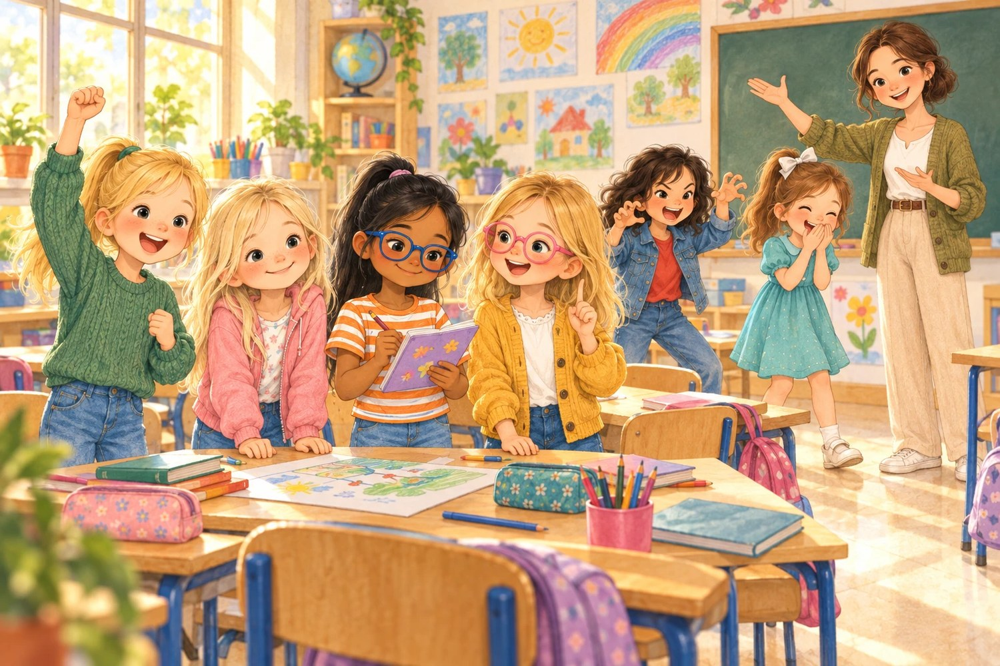
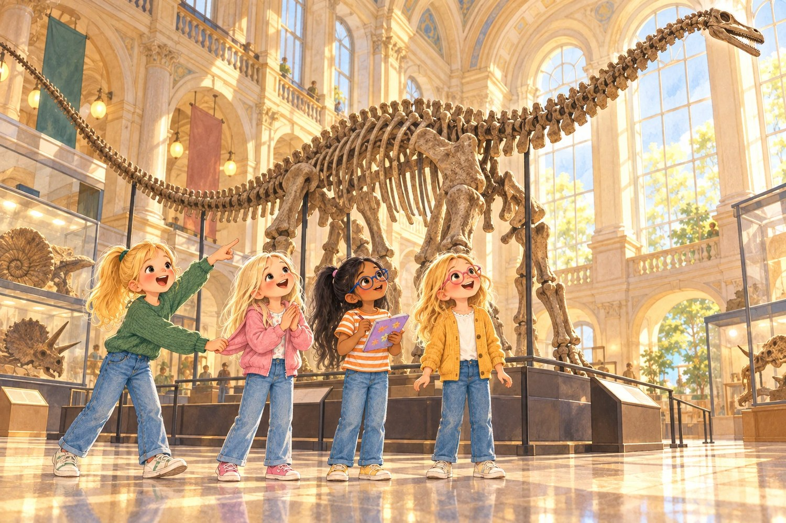
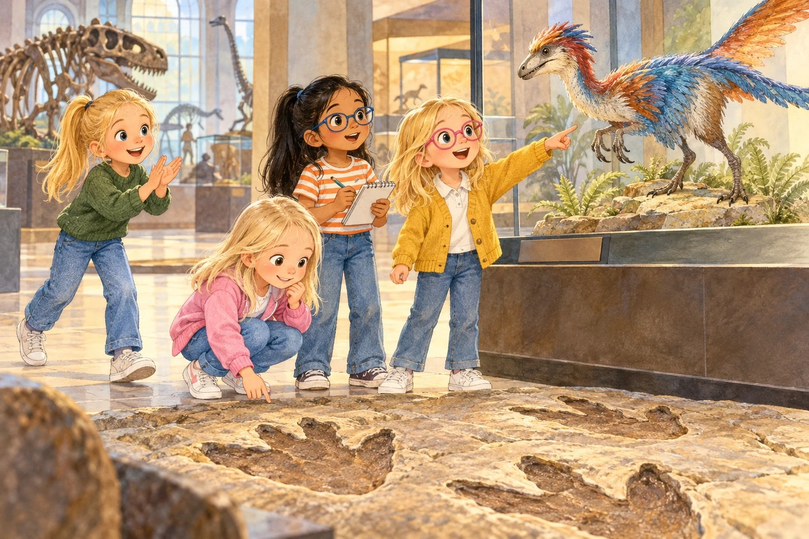
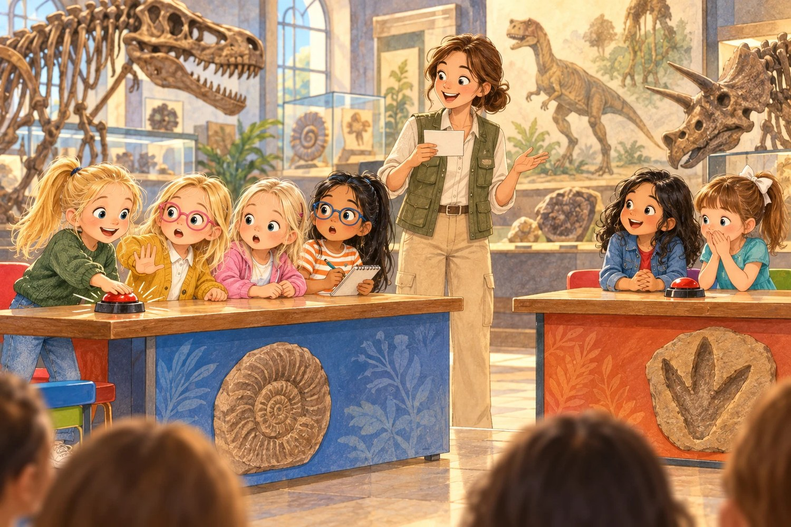
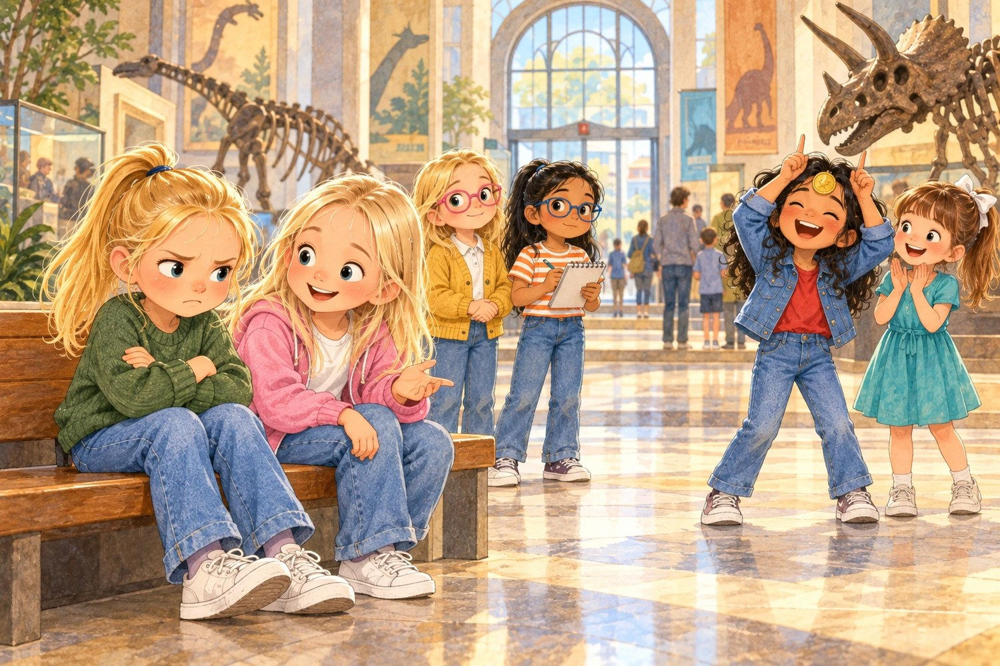
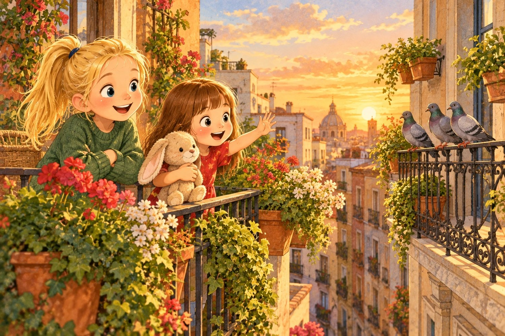

# El concurso de los dinosaurios

> ⏱️ Lectura: unos 15 minutos · 🌍 Tema: los dinosaurios y saber perder · 👧 Protagonistas: Olivia, Claudia, Sofía B, Olaya y Liliana

---

## 1. Equipo Diplodocus

—El jueves nos vamos de excursión al Museo de Ciencias Naturales —anunció la seño Marta—. Vamos a ver dinosaurios.

La clase entera estalló en gritos. Sofía V se puso a rugir como un tiranosaurio y Jana se escondió detrás de su estuche, muerta de risa.

—Y hay más —siguió la seño, levantando la mano para pedir silencio—. Al final de la visita, el museo organiza un concurso de preguntas. Iréis por equipos de cuatro. El equipo ganador se llevará una insignia de paleontólogo.

—¿Qué es un paleontólogo? —preguntó alguien desde el fondo.

—Una persona que estudia los fósiles —explicó Olaya, colocándose sus gafas rosas—. Los restos de animales y plantas que vivieron hace muchísimo tiempo.

Olivia ya no escuchaba. Se había imaginado la insignia brillando en su jersey verde y no podía pensar en otra cosa.

Los equipos quedaron así: Olivia, Claudia, Sofía B y Olaya en uno; Sofía V, Jana, Lucía y Ana en otro. Al equipo de Olivia lo llamaron «Diplodocus». Al otro, «Las Raptoras».

—Vamos a ganar sí o sí —dijo Olivia en el recreo, con los ojos muy serios—. Sofía, tú lo apuntas todo. Olaya, tú te sabes los animales. Claudia… tú mira qué preguntan.

Claudia, que tenía su pelo rubio clarito suelto como siempre y estaba tarareando una canción, sonrió.

—Yo voy a mirar los dinosaurios —dijo—. Para eso vamos, ¿no?

Sofía B anotó algo en su libreta, y por detrás de sus gafas azules se le escapó una sonrisa. Olivia no se dio cuenta. Ya estaba pensando en la insignia.

## 2. El gigante del vestíbulo

Nada más entrar en el museo, las cuatro se quedaron con la boca abierta. En medio del vestíbulo había un esqueleto tan largo que no cabía entero en la mirada. Tenía un cuello larguísimo, una cola todavía más larga y una cabeza pequeñita allá arriba, casi tocando el techo.

—Es un diplodocus —leyó Sofía B en el cartel, y se puso a apuntar a toda velocidad—. Medía más que dos autobuses puestos uno detrás de otro. Y solo comía plantas.

—¿Y esos huesos son de verdad? —preguntó Claudia.

—Muchos fósiles son huesos que, en millones de años, se han ido convirtiendo en piedra —explicó Olaya—. Y en los museos a veces ponen copias, para que los de verdad no se rompan.

Claudia dio una vuelta entera alrededor del esqueleto, despacio, mirando cada vértebra como si fuera un tesoro. Luego se paró debajo de la cola y aplaudió una vez, muy flojito. El sonido rebotó por todo el vestíbulo.

—¡Escuchad qué eco! Aquí dentro cabe una orquesta entera.

—Claudia, no hay tiempo para ecos —dijo Olivia, tirándole de la manga—. Hay que apuntar datos para el concurso. ¡Venga, a la siguiente sala!

—Pero si acabamos de llegar…

—Los dinosaurios no se van a mover. Las Raptoras, sí. Mira, ya van por la sala dos.

Claudia miró el diplodocus una última vez, como quien se despide de un amigo, y siguió a Olivia sin decir nada.

## 3. Plumas y huellas

La segunda sala era la favorita de Olaya. Había una vitrina con la reconstrucción de un dinosaurio pequeño cubierto de plumas de colores.

—¿Dinosaurios con plumas? —se extrañó Sofía B.

—Muchos las tenían —dijo Olaya, con los ojos brillando detrás de sus gafas rosas—. Y lo más alucinante es esto: los pájaros vienen de los dinosaurios. Las gallinas, los gorriones, las palomas del parque… Todos son sus descendientes. Los únicos dinosaurios que quedan vivos.

—¿Las palomas? —Claudia se rio—. Mi abuela les da pan todos los días. ¡Le da pan a unos dinosaurios!

Al lado había una losa de piedra enorme con unas huellas de tres dedos, del tamaño de una sartén.

—Son de La Rioja —leyó Sofía B—. En España hay miles de huellas de dinosaurios, sobre todo allí.

—¡Venga, venga, venga! —Olivia daba palmadas—. ¡Que no nos da tiempo!

Claudia se quedó quieta delante de las huellas.

—Olivia, ¿para qué vienes a un museo si no miras nada?

—Para ganar —contestó Olivia, sin pensarlo.

Olaya iba a decir algo más sobre las palomas, pero Olivia ya se había ido a la sala del tiranosaurio. Se colocó delante del cartel y se puso a leerlo en voz alta, muy deprisa.

—«Brazos cortos, pero muy fuertes. Dientes como plátanos». ¡Apunta, Sofía!

Sofía B apuntó. Pero esta vez no sonreía.

## 4. La última pregunta

El concurso fue en una sala con sillas de colores. Una guía del museo hacía las preguntas y cada equipo tenía un timbre.

—¿Qué es un fósil?

¡Riiing! Diplodocus. Acertaron.

—¿Qué comía el diplodocus?

¡Riiing! Las Raptoras. Acertaron.

Fueron empatadas todo el rato: un punto unas, un punto otras. Olivia se sabía muchas respuestas, pero no esperaba a nadie. Cada vez que alguien de su equipo abría la boca, ella ya había tocado el timbre.

—¿Hace cuánto desaparecieron los grandes dinosaurios?

—¡Hace unos sesenta y seis millones de años! —gritó Olivia—. ¡Cuando chocó un asteroide gigante contra la Tierra!

Punto para Diplodocus. Olivia levantó el puño.

—Última pregunta —anunció la guía—. El equipo que acierte, gana. ¿Qué animales de hoy son descendientes de los dinosaurios?

Olaya se giró hacia Olivia, con la boca ya abierta:

—Olivia, es…

Pero Olivia ya había pulsado el timbre.

—¡Los cocodrilos!

Se hizo un silencio.

—Casi —dijo la guía con una sonrisa—. Los cocodrilos son parientes de los dinosaurios, pero no descienden de ellos. ¿Raptoras?

—¡Los pájaros! —gritaron Sofía V y Jana a la vez.

—¡Correcto! ¡Ganan Las Raptoras!

El otro equipo empezó a saltar y a abrazarse. Lucía y Ana daban vueltas agarradas de las manos. Sofía V rugía de alegría.

Olaya bajó la mirada. Lo sabía. Lo había dicho en la sala de las plumas, delante de todas.

## 5. Un ratito de enfado

Olivia se cruzó de brazos y se sentó en un banco de la entrada, de espaldas a todo el mundo.

—Es injusto —murmuró—. Los cocodrilos también son casi dinosaurios. Y Olaya tenía que haberlo dicho más rápido.

No aplaudió cuando les dieron la insignia a Las Raptoras. Ni siquiera miró.

Claudia se sentó a su lado. Durante un rato no dijo nada. Luego, muy bajito, empezó a tararear.

—¿Sabes cuántos concursos de piano he perdido yo? —dijo al fin—. Cuatro. El año pasado lloré todo el camino a casa.

Olivia la miró de reojo.

—¿Y qué hiciste?

—Me enfadé un ratito. Enfadarse un ratito está permitido. —Claudia se encogió de hombros—. Pero luego fui a darle la enhorabuena a la niña que ganó. Porque ella también había practicado mucho. Y porque, si hubiera ganado yo, me habría gustado que alguien me aplaudiera.

Olivia miró hacia el otro equipo. Sofía V se había puesto la insignia en la frente, como un cuerno de triceratops, y todas se reían.

—Además —siguió Claudia—, Olaya sí lo había dicho. En la sala de las plumas. Lo que pasa es que no la dejaste hablar. Ni a ella, ni a Sofía, ni a mí.

Olivia sintió que se le ponían las orejas rojas. Era verdad. Había corrido tanto detrás de la insignia que no había visto nada: ni el eco del vestíbulo, ni las huellas de La Rioja, ni a sus amigas.

Se levantó despacio. Primero fue a buscar a Olaya.

—Perdona. Tenías razón tú. Y no te dejé decirlo.

Olaya sonrió y le dio un empujoncito con el hombro.

Luego, Olivia fue hasta Las Raptoras, respiró hondo y dijo:

—Enhorabuena. Os lo merecéis.

—¡Gracias! —rugió Sofía V—. ¿Quieres ponerte la insignia un momento? Es para todas.

## 6. Un dinosaurio en el balcón

Esa tarde, en casa, Liliana la esperaba en la puerta con su conejo de peluche en brazos.

—¿Ganaste la medalla de los dinosaurios?

—No —dijo Olivia—. Ganaron las otras.

Liliana puso cara de pena.

—Jo. ¿Y estás triste?

Olivia se lo pensó un momento.

—Un poquito. Pero ¿sabes qué? He aprendido un montón de cosas. Y te voy a contar la mejor.

Se llevó a su hermana al balcón. En la barandilla de enfrente había tres palomas tomando el sol.

—¿Ves esas palomas? Son dinosaurios.

—¡Mentira!

—Verdad verdadera. Los pájaros vienen de los dinosaurios. Me lo enseñó Olaya. Los únicos dinosaurios que quedan en el mundo vuelan y hacen «cu-cú».

Liliana abrió los ojos como platos. Luego se asomó a la barandilla, levantó la mano y gritó con todas sus fuerzas:

—¡Hola, dinosaurios!

Las palomas salieron volando. Liliana se partía de risa y Olivia también.

Esa noche, antes de dormir, Olivia pensó en el diplodocus del vestíbulo, que no había mirado bien. Pensó que el próximo día iría con Claudia, despacio, para escuchar el eco. Y con Olaya, para que le contara todo lo que sabía.

Y se dio cuenta de una cosa curiosa: de lo que más se acordaba del día no era del concurso. Era de Sofía V con la insignia en la frente, rugiendo como un triceratops.

---

> ### 🌟 Moraleja
>
> **Ganar es bonito, pero saber perder es de campeonas.**
> Enfadarse un ratito está permitido; después se aplaude a quien ha ganado. Y lo que aprendes con tus amigas se queda contigo, aunque no te den medalla.

---

### 🦕 Lo que aprendimos sobre los dinosaurios

| Dato | Explicación |
|---|---|
| Los fósiles | Muchos son huesos que, en millones de años, se han ido convirtiendo en piedra. |
| El diplodocus | Medía más que dos autobuses en fila y solo comía plantas. |
| Dinosaurios con plumas | Muchos tenían plumas, y los pájaros de hoy descienden de ellos. |
| Huellas en España | En España hay miles de huellas de dinosaurios, sobre todo en La Rioja. |
| El final | Los grandes dinosaurios desaparecieron hace unos 66 millones de años, después de que chocara un asteroide gigante contra la Tierra. |
| Los cocodrilos | Son parientes de los dinosaurios, pero no descienden de ellos. |

**Pregunta para después de leer:** ¿alguna vez has perdido en un juego? ¿Qué hiciste después?
